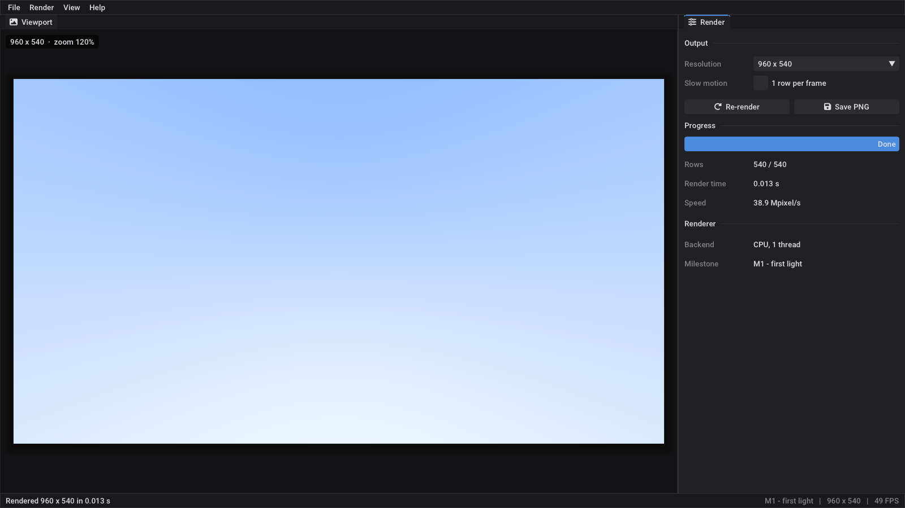

# Umbra

A ray tracer with a GUI, written in C++23.



- **Plan:** [docs/ROADMAP.md](docs/ROADMAP.md): milestones from "first ray" to a CUDA backend
- **Diary:** [docs/DEVLOG.md](docs/DEVLOG.md)
- **For Claude Code:** [CLAUDE.md](CLAUDE.md)

## Building on Linux / WSL

Requirements: CMake ≥ 3.28, Ninja, Git, GCC ≥ 13 (14+ recommended for the later C++23 features),
and the X11 / OpenGL development packages. On Ubuntu:

```bash
sudo apt install build-essential cmake ninja-build git \
    libx11-dev libxext-dev libxrandr-dev libxinerama-dev libxcursor-dev libxi-dev libgl1-mesa-dev
```

Then:

```bash
cmake --preset release          # the first run downloads raylib, Dear ImGui, rlImGui and Catch2
cmake --build --preset release
./build/release/umbra
```

On WSL the window appears on the Windows desktop through WSLg (Windows 11, or Windows 10 with an
up-to-date WSL). Keep the repository inside the Linux file system (e.g. `~/projects/umbra`) rather
than on a Windows drive (`/mnt/c`, `/mnt/d`, ...). Builds are much faster there.

### High-DPI screens

By default (*View ▸ UI scale ▸ Automatic*) Umbra uses the UI scale the system asks for:

- **Windows:** the *Make everything bigger* display setting.
- **Linux:** the X11 resource `Xft.dpi` (96 = 100 %, 120 = 125 %, 144 = 150 %, 192 = 200 %).
  Desktop environments (GNOME, KDE, ...) set it from their own scaling setting.
- **WSLg:** nothing sets `Xft.dpi`, so it counts as 100 %, and on a high-DPI screen the UI looks
  small. Either set it yourself, e.g. in `~/.bashrc` (needs `sudo apt install x11-xserver-utils`):

  ```bash
  [ -n "$DISPLAY" ] && command -v xrdb > /dev/null && echo "Xft.dpi: 144" | xrdb -nocpp -merge
  ```

  (other Linux GUI apps pick it up too), or choose a fixed size under *View ▸ UI scale*.

A fixed size replaces the automatic one; it does not multiply it. The choice is saved in
`~/.config/umbra/settings.ini` (on Windows: `%APPDATA%\Umbra\settings.ini`), next to the panel
layout (`layout.ini`).

### Compiler

For a different compiler, set it on the first configure: `CXX=g++-14 cmake --preset release`
(delete `build/` when you switch compilers).

## Building on Windows (MSVC)

Not tested yet. It should work, because nothing in the code is platform specific. Install
Visual Studio 2022 with the "Desktop development with C++" workload, then either open the folder in
Visual Studio (it reads `CMakePresets.json`), or run this from a *Developer PowerShell for VS 2022*:

```powershell
cmake --preset release
cmake --build --preset release
.\build\release\umbra.exe
```

## Using it

| | |
|---|---|
| **F5** | re-render |
| **Ctrl+S** | save the image to `./renders/` |
| **Ctrl+Q** | quit |
| *Render ▸ Slow motion* | one row per frame, so you can watch it draw |
| *View ▸ UI scale* | *Automatic* (follow the system) or a fixed size, remembered; also **Ctrl + numpad +/−**, **Ctrl + numpad 0** = automatic |
| *View ▸ Reset layout* | put the panels back where they were |
| *View ▸ ImGui demo window* | every ImGui widget, with source, handy for new panels |

Command line:

```bash
./build/release/umbra-cli --width 1280 --height 720 --out renders/test.png   # no window
./build/release/umbra --screenshot renders/ui.png                           # picture of the GUI
./build/release/umbra --ui-scale 1.5                                        # UI scale for this run (also 150%, auto)
```

Tests (Catch2, in `tests/`). Run them in the `debug` preset, where the asserts are on:

```bash
cmake --preset debug && cmake --build --preset debug
ctest --preset debug                      # every test case, plus a CLI smoke test
./build/debug/umbra_tests "[scene]"       # only the cases tagged [scene]
```

## Layout

```
src/core/   the renderer: plain C++, no UI dependencies (later shared with CUDA)
src/io/     framebuffer -> PNG
src/ui/     the look (theme: colors, fonts, UI scale) and small ImGui widgets
src/app/    the GUI (raylib + Dear ImGui docking + rlImGui); panels/ has one file per window
src/cli/    headless renderer
tests/      unit tests of the core (Catch2), one <name>_test.cpp per core file
cmake/      pinned third-party dependencies
docs/       roadmap, devlog, gallery
```

Each directory under `src/`, and `tests/`, is one CMake target with its own `CMakeLists.txt`. The table in
the root `CMakeLists.txt` shows what links what.

## Gallery

| M0 — skeleton | M1 — first light |
|---|---|
|  |  |

## Credits

[raylib](https://www.raylib.com/) (zlib), [Dear ImGui](https://github.com/ocornut/imgui) (MIT),
[rlImGui](https://github.com/raylib-extras/rlImGui) (zlib), Font Awesome Free icons (via rlImGui),
Roboto font (Apache 2.0, shipped with Dear ImGui). The rendering part follows Peter Shirley's
[_Ray Tracing in One Weekend_](https://raytracing.github.io/) series.
