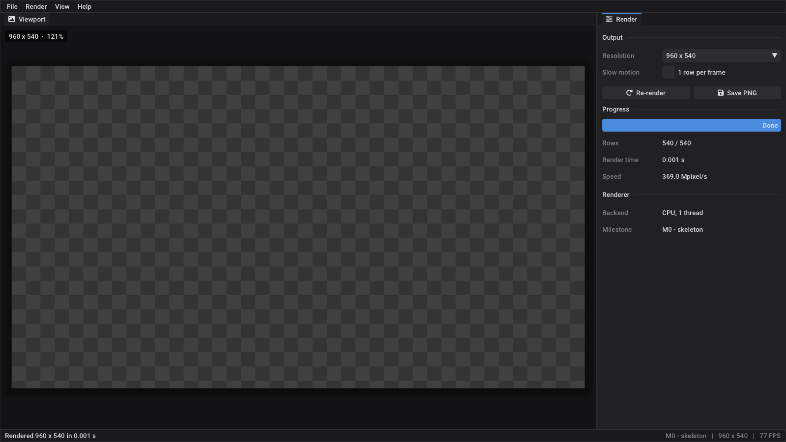

# Umbra

A ray tracer with a GUI, written in C++23.



- **Plan:** [docs/ROADMAP.md](docs/ROADMAP.md): milestones from "first ray" to a CUDA backend
- **Diary:** [docs/DEVLOG.md](docs/DEVLOG.md)
- **For Claude Code:** [CLAUDE.md](CLAUDE.md)

## Building on Linux / WSL

Requirements: CMake ≥ 3.25, Ninja, Git, GCC ≥ 13 (14+ recommended for the later C++23 features),
and the X11 / OpenGL development packages. On Ubuntu:

```bash
sudo apt install build-essential cmake ninja-build git \
    libx11-dev libxext-dev libxrandr-dev libxinerama-dev libxcursor-dev libxi-dev libgl1-mesa-dev
```

Then:

```bash
cmake --preset release          # the first run downloads raylib, Dear ImGui and rlImGui
cmake --build --preset release
./build/release/umbra
```

On WSL the window appears on the Windows desktop through WSLg (Windows 11, or Windows 10 with an
up-to-date WSL). Keep the repository inside the Linux file system (e.g. `~/projects/umbra`) rather
than under `/mnt/c`. Builds are much faster there.

For a different compiler, set it on the first configure: `CXX=g++-14 cmake --preset release`
(delete `build/` when you switch compilers).

## Building on Windows (MSVC)

Not tested yet. It should work, because nothing in the code is platform specific. Install
Visual Studio 2022 with the "Desktop development with C++" workload, then either open the folder in
Visual Studio (it reads `CMakePresets.json`), or run this from a *Developer PowerShell for VS 2022*:

```powershell
cmake --preset release
cmake --build --preset release
.\build\release\umbra.exe
```

## Using it

| | |
|---|---|
| **F5** | re-render |
| **Ctrl+S** | save the image to `./renders/` |
| **Ctrl+Q** | quit |
| *Render ▸ Slow motion* | one row per frame, so you can watch it draw |
| *View ▸ Reset layout* | put the panels back where they were |
| *View ▸ ImGui demo window* | every ImGui widget, with source, handy for new panels |

Command line:

```bash
./build/release/umbra-cli --width 1280 --height 720 --out renders/test.png   # no window
./build/release/umbra --screenshot renders/ui.png                           # picture of the GUI
ctest --preset release                                                      # tests
```

## Layout

```
src/core/   the renderer: plain C++, no UI dependencies (later shared with CUDA)
src/io/     framebuffer -> PNG
src/app/    the GUI (raylib + Dear ImGui docking + rlImGui)
src/cli/    headless renderer
cmake/      pinned third-party dependencies
docs/       roadmap, devlog, gallery
```

## Gallery

| M0 — skeleton |
|---|
|  |

## Credits

[raylib](https://www.raylib.com/) (zlib), [Dear ImGui](https://github.com/ocornut/imgui) (MIT),
[rlImGui](https://github.com/raylib-extras/rlImGui) (zlib), Font Awesome Free icons (via rlImGui),
Roboto font (Apache 2.0, shipped with Dear ImGui). The rendering part follows Peter Shirley's
[_Ray Tracing in One Weekend_](https://raytracing.github.io/) series.
